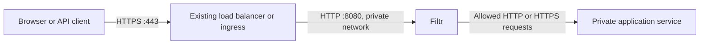

# Infrastructure and HTTP behavior

[Back to deployment choices](../README.md)

## Where Filtr goes in your infrastructure

Filtr is a reverse proxy: it receives an HTTP request, inspects it, and either blocks it or forwards it to your application. The application is its **upstream**, also called the next hop. You must route requests through Filtr to protect them.



Responses return through Filtr and the entry point to the client. Filtr currently accepts plaintext HTTP; your existing load balancer, ingress or TLS proxy keeps the public certificate and terminates HTTPS. Use a protected network for the HTTP connection from that entry point to Filtr.

There are **two routing settings** to change:

| Setting | Where you change it | Example |
| --- | --- | --- |
| Send incoming requests to Filtr | Your existing load balancer, ingress or reverse proxy's backend/target | Change the application backend to `filtr:8080`. |
| Send allowed requests to your application | Filtr's `FILTR_UPSTREAM` environment variable or `--upstream` flag | `http://application:3000` on Docker, or `http://application.default.svc.cluster.local:3000` on Kubernetes. |

Usually your public DNS record stays pointed at the same load balancer. Change that load balancer's backend to Filtr. If you move the public entry point to a different address, update DNS too. Setting `FILTR_UPSTREAM` configures only the connection **from Filtr to the application**; it does not change how traffic arrives at Filtr.

For example, a native Filtr process on the same host as the application can use:

```dotenv
FILTR_LISTEN=127.0.0.1:8080
FILTR_UPSTREAM=http://127.0.0.1:3000
```

The HTTPS proxy on that host then forwards to `http://127.0.0.1:8080`. In containers, `127.0.0.1` refers to that container, so use the application container's network name instead. `FILTR_UPSTREAM` must be an HTTP(S) origin with an optional port, without a path, credentials, query or fragment. Filtr preserves the incoming request path and query. Never point it back to Filtr or the public hostname that routes into Filtr. Configuration changes require a restart; Compose environment changes require recreating the container.

### What the infrastructure needs

- **An HTTPS entry point.** Keep certificate management, slow-header protection, connection limits, rate limiting and DDoS protection there. It must forward HTTP to Filtr's port 8080 using a request format Filtr supports; see [HTTP behavior](operations.md#http-behavior).
- **A private application address.** Filtr must resolve and reach the application host/Service and port. Remove public routes directly to the application and restrict its HTTP port to Filtr using network/firewall rules. Include alternate domains, IPv6 addresses and internal entry points when checking for bypasses. Keep required health/operational access narrowly scoped.
- **Private administration and persistent storage.** Port 9090 stays on loopback and requires the 64-byte admin secret. Use SSH for native installs, `docker exec` for containers, or `kubectl port-forward` for Kubernetes. Persist `/data` in containers so the SBOM, leaderboard snapshot and review cache survive replacement.
- **Outbound DNS and HTTPS.** Allow Filtr to reach `vercel.com:443` for leaderboard updates, and the configured providers (`api.openai.com:443` and/or `api.anthropic.com:443`). These calls happen during policy processing, outside the request inspection path. Proxied requests and bodies are never sent to these services; see [inventory disclosure to AI providers](ai.md#ai-providers-leaderboard-selection-and-backup).
- **An inventory update step in deployment.** Upload the exact deployed environment's SBOM after dependency/image changes, inspect the coverage report, and check ordinary application traffic. Before the first upload, public requests return 503. Matching request filters return 403; unrelated requests continue. Operator blocking or explicitly enabled critical-risk automation can stop all public requests. Health checks can pass while emergency blocking is active.

Filtr has one upstream per instance. Use separate instances for independent applications. A shared gateway can use an internal router as its upstream if it accepts Filtr's preserved public Host and canonical forwarding metadata; a combined inventory applies restrictions to the whole gateway. Filtr does not route individual components or CVEs to particular services. Database protocols and traffic that bypasses its HTTP listener are outside its protection.

Before switching live traffic, check login, redirects, cookies, uploads and API calls through Filtr. Filtr preserves a validated original `Host` while connecting to the fixed upstream origin. Configure exact trusted proxy IPs to preserve the original client address and HTTPS scheme; untrusted peers cannot supply forwarding metadata. WebSockets and several streaming request formats remain unsupported.

Follow the [Docker](development.md#docker) or [Kubernetes](kubernetes.md) guides for concrete wiring.

## Configuration from .env

Filtr automatically loads `.env` from its **current working directory** before starting Tokio or parsing configuration. Existing process environment variables take precedence over the file; CLI flags take precedence over both. Missing `.env` files are allowed. Malformed/unreadable files stop startup with a generic error that does not print file contents. Parent directories are not searched. Comments, quoted values and `export KEY=value` syntax are supported by [dotenvy](https://docs.rs/dotenvy/0.15.7/dotenvy/fn.from_path.html).

Use [.env.example](../.env.example) as a template when creating a new file. Keep an existing file containing your provider key. Add `FILTR_ADMIN_TOKEN` with a value from `openssl rand -hex 64`, and set `FILTR_UPSTREAM` for native runs. Empty provider keys should be omitted/commented out. Restrict the file with `chmod 600 .env`; `.env` and `.env.*` are ignored by Git except for the example. Configuration changes take effect after restart.

With a complete `.env`, run the native server with `cargo run --locked --bin filtr`. Container environments can instead use `docker run --env-file .env ...`; the [Compose recipe](development.md#local-compose-demo) explicitly injects `.env` at runtime. The file is excluded from image builds.

## HTTP behavior

- Buffer and inspect the entire inbound body before sending any bytes upstream. Default: 1 MiB per request, 128 in-flight requests, 10-second body deadline and upstream total timeout. Concurrency permits remain held until the downstream response is consumed or dropped.
- Compile token rules into an Aho–Corasick matcher when an SBOM is installed. Plain requests avoid normalization allocations. No CVE lookups, regex compilation, disk access or policy write locks in the traffic path.
- Scan raw bytes plus up to four rounds of percent decoding and JSON Unicode/backslash escape decoding. Reject deeper encoding. Forward the original inspected bytes, rather than the decoded inspection view.
- Always reject NULs, request-target traversal and `/.env` / `/.git` probes. Support GET, HEAD, POST, PUT, PATCH, DELETE and OPTIONS, subject to active rules. Reject method-override headers and nonempty GET/HEAD bodies.
- Reject compressed request bodies, declared non-UTF-8 charsets, chunked requests/trailers, CONNECT, TRACE and protocol upgrades, including WebSockets. Clients must send a known Content-Length for request bodies. This deliberately breaks some streaming uploads and clients.
- Rebuild requests to one fixed upstream origin while preserving the validated public Host. Strip hop-by-hop headers, including names nominated by `Connection`. Default forwarding metadata uses the socket peer and `http`. `FILTR_TRUSTED_PROXIES` accepts exact peer IPs allowed to provide one `X-Forwarded-For` IP and `X-Forwarded-Proto` (`http` or `https`); duplicate, comma-chain or invalid trusted values are rejected. Trusted `X-Forwarded-Host`, if supplied, must match Host. Rebuild canonical `X-Forwarded-Host`, `-For`, `-Proto`, `-Port` and `X-Real-IP`, removing other forwarding fields. The trusted edge must overwrite client-supplied values. Optional `FILTR_ALLOWED_HOSTS` restricts public hostnames without ports; malformed/unknown hosts return 400. HTTP/1.0 without Host or an allowlist uses the upstream host.
- Preserve upstream status codes, duplicate headers such as Set-Cookie, and response bodies. Stream responses without decompressing them. Pass redirects back to the client without following them. Upstream connection failures return 502; timeouts before response headers return 504. Failures after headers terminate the body stream and increment the error counter.
- Filtr's logs contain rule IDs and counts, without request URLs, headers or bodies. `RUST_LOG=filtr=info` is the default; individual blocks are counted without per-request logging. Use `RUST_LOG=filtr=debug` to log each block. Avoid enabling dependency trace logs on sensitive traffic. Block responses expose a reason/rule ID.

Public requests never reach Filtr's admin API. `/v1/status` on the public port is an ordinary upstream path. Keep the origin inaccessible to external clients, otherwise attackers can bypass Filtr.

## Initial catalogue

| CVE | Package | Request restriction |
| --- | --- | --- |
| [CVE-2021-44228](https://logging.apache.org/security.html#CVE-2021-44228) | Maven `org.apache.logging.log4j/log4j-core` | Block every `${` lookup expression, including ordinary interpolation. Scan request target, header names/values and complete body. |
| [CVE-2025-55182](https://react.dev/blog/2025/12/03/critical-security-vulnerability-in-react-server-components) | npm `react-server-dom-webpack`, `react-server-dom-parcel`, `react-server-dom-turbopack` | The existing broad method restriction is advisory-only; report the CVE for SRE action without disabling every write. |

Version ranges and source URLs live in [`rules/default.json`](https://github.com/meiroio/filtr/blob/v0.1.1/rules/default.json). The bundled catalogue contains curated examples; AI supplies automatic vulnerability discovery for the uploaded inventory. The RSC catalogue entry is a broad advisory-only method restriction; the Log4j entry is an enforced payload heuristic. Neither is a vendor-certified mitigation or a complete protocol validator.

Add newly researched rules by copying the catalogue and starting with `--rules /path/to/catalogue.json`. This **replaces** the bundled catalogue; retain existing entries you need. Catalogue changes require a restart; SBOM changes do not. The catalogue is operator-controlled and is never fetched from the internet in the request path.

Each rule requires a unique `id`, `cve`, versionless `packages` PURLs, an `affected` array of Rust semver requirements (OR across entries), a `description`, an HTTPS `source`, and an action. Use these enforced actions:

```json
{"type": "tokens", "patterns": ["specific-dangerous-marker"]}
```

`tokens` and `request` are enforced after validation. Legacy catalogue `deny_write` and `deny_all` actions remain accepted as advisory-only metadata; they do not take the application offline. Use `/v1/traffic` for a deliberate shutdown. Token matching is ASCII case-insensitive. A scoped catalogue action has shape `{"type":"request","filter":{...}}`, using the same fields as an [AI discovery's `restriction`](ai.md#ai-vulnerability-discovery-and-blocking-rules). Custom catalogues are intended for reviewed virtual patches, not unverified CVE summaries.

## Deployment limits

This MVP has not had an independent security review, fuzzing campaign or production load test. It is not a replacement for a mature WAF. Application-specific transformations can hide a payload from curated or AI token inspection. AI research can miss vulnerabilities, and vulnerabilities outside the HTTP path remain outside its filtering coverage. Whole-upstream quarantine blocks HTTP access without diagnosing exploitability, and does not stop non-HTTP access or repair an already compromised origin. False positives are possible; opt-in emergency automation or manual blocking can deliberately interrupt application availability. AI output needs real-world evaluation before relying on it as a narrow mitigation.

Public TLS termination, header-read deadlines, connection limits, rate limiting and DDoS protection belong to a trusted ingress in front of this prototype. Its application body deadline starts after HTTP headers arrive; idle/slow-header connections are not bounded by `--max-in-flight`. Ensure that ingress preserves the request representation Filtr inspects, and that every path to the origin passes through Filtr. Keep the admin token, SBOM storage and rule catalogue writable only by the operator. Prefer a patched application over permanent dependence on a virtual patch.
